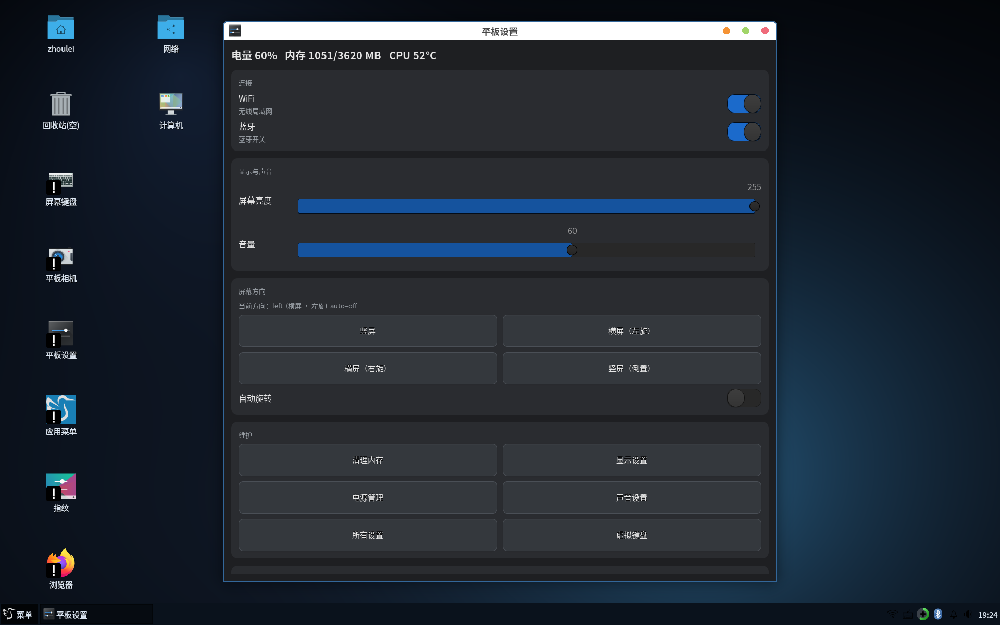
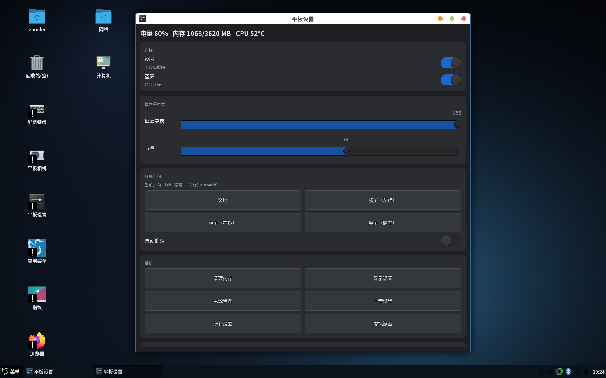
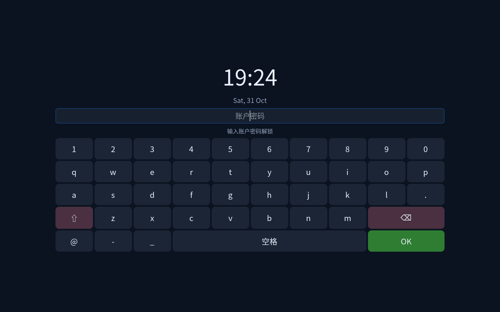

# 小米平板 4 Plus（clover / SDM660）postmarketOS 桌面 Linux 移植

把 **Xiaomi Mi Pad 4 Plus**（代号 `clover`，Qualcomm SDM660）跑成一台**能日常用的
Linux 平板**：labwc + LXQt 桌面、触摸/旋转、中文输入、浏览器看视频、锁屏、
摄像头、以及一整套可 TWRP 恢复的镜像。

> **这不是一个"官方发行版"**，而是一份**完整的移植记录 + 可复现的补丁/脚本/镜像**。
> 每个硬件都写清楚：**我们怎么解决的、还差什么、为什么差**。





---

## 致谢（Standing on the shoulders of giants）

这个项目能跑起来，绝大部分功劳属于下面这些人和项目——**本仓库只是在他们打好的地基上做了设备适配**：

| 来源 | 我们用了什么 |
|---|---|
| **[postmarketOS](https://postmarketos.org/)** | 整个发行版基础（apk 包管理、pmbootstrap、设备包框架、initramfs、boot-deploy） |
| **[sdm660-mainline/linux](https://github.com/sdm660-mainline/linux)** | SDM660 主线内核与设备树（`msm`/`dpu`/`camss`/`venus`/`ath10k`/`qcom_smgr` 等驱动） |
| **HandsomeHacker** | SDM660 平台早期 bring-up、设备树与显示/触摸相关工作 |
| **[sdm660-mainline 社区](https://github.com/sdm660-mainline)** | 大量 SDM660 设备（clover、lavender、wayne…）的共享 dtsi 与调试经验 |
| **Linux 内核社区** | `msm` DRM、`goodix_ts`、`qcom_smgr`、`ath10k`、`qcom-smbx`、`venus` 等所有上游驱动 |
| **[wlroots](https://gitlab.freedesktop.org/wlroots/wlroots) / [labwc](https://github.com/labwc/labwc)** | Wayland 合成器（layer-shell、旋转、触摸映射） |
| **[LXQt](https://lxqt-project.org/)** | 桌面环境（面板、文件管理器、设置） |
| **[Mesa](https://www.mesa3d.org/) / freedreno** | Adreno 512 的 OpenGL 实现（以及我们在下游内核上踩到的坑） |
| **Android 厂商固件** | 用于逆向核对器件、ACDB 音频参数、相机 tuning |

> 如果上面遗漏了你的项目，请开 issue 或 PR，我们立刻补上。

---

## 默认账号与密码

| 项目 | 值 |
|---|---|
| 用户名 | `zhoulei` |
| 密码 | `147258` |
| sudo | 同密码（`sudo` 可用） |
| root | 默认无密码登录被禁用，用 `sudo -i` |
| 锁屏 | 同一个账户密码（自带屏幕键盘，无需实体键盘） |
| SSH | 默认开启，`ssh zhoulei@<平板IP>` |

> ⚠️ 这是**测试机镜像**的默认凭据，公开在仓库里。请在你自己的设备上第一时间改掉：
> `passwd`、`sudo passwd`。

---

## 硬件状态总表

图例：✅ 可用 ｜ 🔧 可用但有条件 ｜ ⚠️ 部分/未验证 ｜ ❌ 未解决（附根因）

| # | 硬件 | 状态 | 一句话结论 |
|---|---|---|---|
| 1 | 显示（DSI / NT51021） | ✅ | 主线 panel 驱动，横屏靠 `transform 90` |
| 2 | 触摸（Goodix GT9xx） | ✅ | 需要 udev 标定矩阵与旋转严格同步 |
| 3 | GPU（Adreno 512） | 🔧 | 需内核 + Mesa 双重加固才不卡死 |
| 4 | 视频硬解（Venus） | ✅ | mpv `v4l2m2m` 可用；浏览器用不上（无 VA-API） |
| 5 | Wi-Fi（WCN3990） | 🔧 | 稳，但**调制解调器一崩就带着它一起挂** |
| 6 | 蓝牙（WCN3990） | ✅ | 可用 |
| 7 | 音频（WCD + TAS2557） | ✅ | PulseAudio 48 kHz，含喇叭/耳机/麦克风 |
| 8 | 充电 / 电量计 | ✅ | SMB2 + SMB1351 + PMI8998 FG |
| 9 | USB-C / OTG | 🔧 | 自动角色切换；**硬复位后 CC 检测失效，需重启** |
| 10 | 调制解调器（LTE） | ⚠️ | 能注网，但 **~3 分钟后 assert**；无 IPA 驱动 |
| 11 | GPS | ⚠️ | QMI LOC 有响应，**从未取得定位** |
| 12 | 后摄（OV13855） | ✅ | camss 采集 + 自研 ISP 预览程序 |
| 13 | 前摄（S5K5E8） | ❌ | CCI 无 ACK（Android 下正常） |
| 14 | 指纹（FPC1020） | ❌ | 硬件可控，**成像在闭源 TEE TA 里** |
| 15 | 传感器（accel/gyro/mag/ALS/hall） | ✅ | `qcom_smgr` 直读；ALS 自动背光 |
| 16 | 电源键 / 音量键 / 锁屏 | ✅ | 自研 `tablet-powerkeyd` + 触摸 PIN/密码锁 |
| 17 | 屏幕键盘 + 中文输入 | ✅ | wvkbd + fcitx5（另配 PAM 版锁屏键盘） |
| 18 | 自动旋转 | ✅ | 加速度计 + 旋转与触摸矩阵联动 |
| 19 | 深度休眠（suspend） | ❌ | `mdss_runtime_suspend` 死锁，改用**伪睡眠** |
| 20 | SD 卡 / eMMC | ✅ | 读写正常 |

**逐项的解决步骤与未解决原因 → [`docs/HARDWARE.md`](docs/HARDWARE.md)**

---

## 快速开始

### 从零安装（已有 postmarketOS 基础系统时）

```sh
# 1. 内核：用 sdm660-mainline/linux 编译，设备树 clover
# 2. boot.img 刷入 boot 分区（fastboot flash boot boot.img）
# 3. rootfs：本仓库的 restore 包（见下）

# 4. 应用本仓库的适配层（推荐，一条命令）
git clone https://github.com/zhoulei135770/xiaomipad4plus_postmarketos_Desktop_linux.git
cd xiaomipad4plus_postmarketos_Desktop_linux
sudo ./install.sh          # 安装驱动脚本/服务/桌面配置/输入法/锁屏
sudo reboot
```

### 恢复（TWRP / fastboot）

镜像包在 **[Releases](https://github.com/zhoulei135770/xiaomipad4plus_postmarketos_Desktop_linux/releases)**：

| 文件 | 用途 |
|---|---|
| `twrp-3.7.0_9-0-clover-mipad4.img` | TWRP 3.7.0 recovery（60 MB，`fastboot boot` 即可临时启动） |
| `clover-restore-*.z01` + `*.zip` | **完整恢复包分卷**（1500 MB + 1224 MB，GitHub 单附件上限 2 GiB 故分卷） |
| `*.sha256` | 校验文件 |

**分卷合并**（下载 .z01 和 .zip 到同一目录后）：

```sh
zip -s 0 clover-restore-20261031.zip --out full.zip   # 自动合并
sha256sum -c clover-restore-20261031.sha256
# 合并后的 full.zip 就是 TWRP 可刷的完整包
```

```sh
# 推荐顺序：fastboot 刷内核（小、稳）→ TWRP 刷整包
fastboot boot twrp-3.7.0_9-0-clover-mipad4.img
# TWRP: Install → full.zip → Reboot System
```

> ⚠️ 镜像约 2.6 GB，**长时间传输容易中断**：
> 下载请用 `curl -C -` 断点续传，务必 `sha256sum -c` 校验。
> 完整的刷机策略、分卷合并、失败恢复见 **[`docs/FLASHING.md`](docs/FLASHING.md)**。
> 包内容校验（UUID / 权限 / 架构）见 [docs/RESTORE-VERIFY.md](docs/RESTORE-VERIFY.md)。
> **实测验证报告（21 项全部通过）**：[docs/VERIFICATION.md](docs/VERIFICATION.md)

---

## 桌面与交互

| 组件 | 选择 | 原因 |
|---|---|---|
| 合成器 | **labwc**（wlroots） | 轻、layer-shell 完整、旋转/触摸映射可靠 |
| 桌面 | **LXQt** | 面板 + 文件管理器 + 中文齐全，资源占用低 |
| 输入法 | **fcitx5** + wvkbd 屏幕键盘 | 无实体键盘也能打中文 |
| 锁屏 | 自研 `tablet-pinlock`（GTK4 layer-shell） | gtklock 的 session-lock 会挡住所有屏幕键盘 |
| 电源键 | 自研 `tablet-powerkeyd` | logind 的默认行为不满足"短按关屏/长按菜单" |

---

## 仓库结构

```
docs/            移植全过程记录（00…67，按时间与主题）
  HARDWARE.md    ★ 每个硬件的解决步骤 + 未解决原因
  RESTORE-VERIFY.md  镜像包校验方法
etc/             需要放到系统里的配置（udev/systemd/modprobe.d）
tools/device/    设备端脚本（电源键、锁屏、旋转、USB 角色、相机…）
patches/         内核补丁
screenshots/     界面截图
```

---

## 重要提醒（给后来者）

1. **不要让调制解调器长时间在线**——它会 assert 并拖垮 Wi-Fi。
2. **不要 `systemctl restart systemd-logind`**——会收回图形会话 seat，屏幕直接黑。
3. **`msm` 是内置模块**，`modprobe.d` 对它无效，GPU 加固必须用 systemd 服务。
4. **旋转与触摸矩阵必须同时改**，否则点击会差 90°/180°。
5. **真正的 suspend 会死锁**，本项目用伪睡眠代替。

---

## 许可证

- 本仓库的脚本与文档：**MIT**
- 内核补丁：遵循 Linux 内核的 **GPL-2.0**
- 引用的第三方项目版权归各自作者所有
