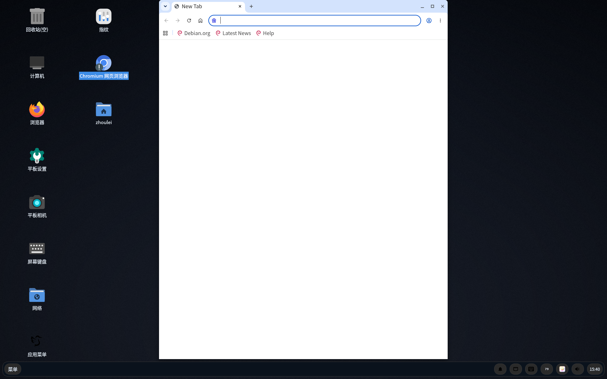

# 小米平板 4 Plus（clover-plus）Debian arm64 移植

把 **Xiaomi Mi Pad 4 Plus（SDM660 / clover-plus）** 从 postmarketOS 换成
**Debian forky arm64 + labwc + LXQt 2.4** 的可复现配置仓库。

- 设备：`clover-plus`，Snapdragon 660（4×A73 + 4×A53），Adreno 512，4 GB RAM，10.1" 1920×1200
- 系统：Debian **forky** arm64 rootfs（`/dev/mmcblk1p64`，ext4，UUID `8def993b-42f5-4ba1-9813-c046e498fe22`）
- 启动：**保留原 pmOS boot 分区不动**（boot.img + 内核 `7.0.14-sdm660`），只替换 userdata
- 桌面：labwc 0.20.2（wlroots 0.20.2）+ LXQt 2.4（Qt6）/ greetd / fcitx5 / wvkbd
- 主题：Onyxian-Rounded（LXQt QSS + palette + Kvantum `Orchis-solid`）+ Papirus

## 现在能用的

| 功能 | 状态 | 说明 |
|---|---|---|
| 显示 / 触摸 | ✅ | DSI nt51021，90° 横屏 + `tablet-touch-matrix` 触摸矩阵 |
| WiFi | ✅ | ath10k / WCN3990，firmware 走 QMI-TFTP（`tqftpserv`） |
| 蓝牙 | ✅ | WCN3990，需要 `btmgmt public-addr 02:00:29:4B:23:B3`（`bt-address.service`） |
| GPU / 3D | ✅ | freedreno FD512，GL 3.1 / GLES 3.1，桌面 GPU 合成 |
| 自动旋转 | ✅ | `tablet-orientd` 读 BMI120 加速度计，四方向都验证过 |
| 自动亮度 | ✅ | CM3232 ALS（IIO） |
| 声音 | ✅ | PulseAudio + UCM2（`Xiaomi/clover`），音量键 OSD 延迟 131–164 ms |
| 锁屏 / PIN | ✅ | `tablet-pinlock`（GTK4 layer-shell + PAM） |
| 通知 / 音量 OSD | ✅ | `lxqt-notificationd` + 固定 id 替换 |
| 相机（后置） | ⚠️ | 可用但未做自动对焦调优 |
| 4G 数据 | ❌ | IPA 未打通（见 `docs/HARDWARE.md`） |
| 麦克风 | ❌ | 采集 PCM `hw:X4,1` 返回 EINVAL，UCM 里已移除采集设备以保证播放正常 |
| 指纹 | ❌ | Goodix 驱动未适配 |

## 快速刷机

镜像在 [Releases](../../releases) 里，按分卷上传（`*.img.gz.part-*`）。

```bash
# 1. 合并 + 解压
cat debian-rootfs-v13.img.gz.part-* > debian-rootfs-v13.img.gz
gzip -d debian-rootfs-v13.img.gz

# 2. 校验（对照 SHA256SUMS）
sha256sum -c SHA256SUMS

# 3a. fastboot（推荐）
fastboot flash userdata debian-rootfs-v13.img
fastboot reboot

# 3b. 或在 recovery/TWRP 里直接 dd
adb push debian-rootfs-v13.img /sdcard/
adb shell "su -c 'dd if=/sdcard/debian-rootfs-v13.img of=/dev/block/by-name/userdata bs=4M'"
```

> ⚠️ **只动 userdata**。不要刷 boot / dtbo / vbmeta —— 启动链仍然是 pmOS 的，
> 刷坏 boot 会直接黑砖（可用 `fastboot flash boot tools/pmos-boot.img` 救回）。
>
> 刷之前先备份：`adb pull /dev/block/by-name/userdata userdata-backup.img`（或用 TWRP 备份）。

详细步骤见 [`docs/FLASH.md`](docs/FLASH.md)。

## 从零构建

不需要官方镜像，全部脚本在 [`scripts/`](scripts)：

```bash
# 在 x86_64 Debian/Ubuntu 上（需要 qemu-user-static + mmdebstrap）
sudo ./scripts/build-base.sh          # mmdebstrap 生成 forky arm64 rootfs
sudo ./scripts/setup-rootfs.sh        # 装桌面、驱动、配置
sudo ./scripts/make-image.sh out.img 8G
```

细节见 [`docs/BUILD.md`](docs/BUILD.md)。

## 关键配置文件

| 路径 | 作用 |
|---|---|
| `configs/home/zhoulei/.config/labwc/rc.xml` | 窗口规则、快捷键、圆角 |
| `configs/home/zhoulei/.config/lxqt/panel.conf` | 面板（`panelSize=63`，注意不是 `height`） |
| `configs/home/zhoulei/.config/lxqt/lxqt.conf` | 主题 / 图标 / 语言 |
| `configs/usr/local/bin/tablet-orientd` | 自动旋转守护进程（IIO 缓冲 + 阈值 `0.6/scale`） |
| `configs/usr/local/bin/tablet-powerkeyd` | 电源键（短按锁屏 / 长按菜单）+ 音量 OSD |
| `configs/usr/local/bin/tablet-battery-sni` | 电量百分比托盘图标（绕过 UPower，直读 sysfs） |
| `configs/usr/share/alsa/ucm2/Xiaomi/clover/` | UCM2 声卡配置（已移除采集设备） |
| `configs/etc/systemd/system/bt-address.service` | 蓝牙地址修复 |

## 已知坑（都踩过了）

1. **`panelSize` 不是 `height`**：LXQt 面板尺寸键是 `panelSize`，改小（44/56）会让内容被裁掉，看起来"面板不见了"。
2. **labwc `rc.xml` 注释必须闭合**：写坏一个 `<!--` 会在屏幕顶部拉出红条 "Config errors detected"（labnag）。
3. **壁纸键是大写 `Wallpaper=`**：pcmanfm-qt 的 `wallpaper=` 小写不生效；旋转输出还要 `TransformWallpaper=true`。
4. **rotate-restore 之后要重启 panel/pcmanfm**：它们比旋转早启动，会拿到 1200×1920 的旧尺寸。
5. **`sns.reg` 必须是 25468 字节、644**：复制成 0 字节 → 传感器全灭（`/dev/iio:device*` 不出现）。
6. **orientd 阈值要按 scale 算**：`THRESHOLD = 0.6 / in_accel_scale`（本机 ≈ 39323），写死 380000 永远不触发。
7. **音量键 80 秒延迟**：UCM 采集 PCM 探测失败 → PA 每 4 秒重试并卡住主循环。删掉 UCM 里的 `Mic` / `Headset Mic` 设备后恢复。
8. **Firefox 别用 GPU WebRender**：freedreno + WebRender(OpenGL) 会黑屏/花字；软件合成能显示但吃一个核，日常建议 Chromium。
9. **星火商店要 `--disable-gpu`**：Electron 在 freedreno 上 GPU 渲染会把中文画成方块/缺字。
10. **`tablet-powerkeyd` 的 fd EOF**：input 设备消失后 `select()` 一直返回可读 → 95% CPU 空转，代码里已处理。

## 更新日志

见 [`docs/CHANGELOG.md`](docs/CHANGELOG.md)。当前版本 **v13**。

## 参考

- postmarketOS wiki: <https://wiki.postmarketos.org/wiki/Xiaomi_Mi_Pad_4_Plus_(clover-plus)>
- 上游主题: <https://github.com/Ali-v1074/LXQt-Onyxian-Rounded>（GPL-3.0）
- 星火商店: <https://gitee.com/spark-store-project/spark-store>

## License

文档与脚本：MIT。镜像内包含的第三方软件遵循各自许可证（Debian 主仓库、pmOS 内核、Papirus、Kvantum 主题等）。


## 截图

当前桌面（1920×1200，labwc + LXQt 2.4，Onyxian-Rounded 主题）：



## 下载（v13）

- Release: <https://github.com/zhoulei135770/xiaomipad4plus_postmarketos_Desktop_linux/releases/tag/v13>
- 资产：`debian-rootfs-v13.img.gz`（1.33 GB）+ `SHA256SUMS`
- SHA-256（解压后镜像）：`6ECCD964AAB33F3C95F9CDEA9A1EB5B03A1FC75F998C166C293EECF42A789C22`
- 文件系统 UUID：`8def993b-42f5-4ba1-9813-c046e498fe22`

```bash
gzip -d debian-rootfs-v13.img.gz
sha256sum -c SHA256SUMS
fastboot flash userdata debian-rootfs-v13.img
```
